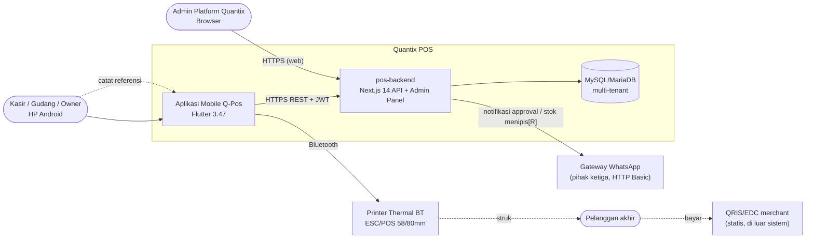
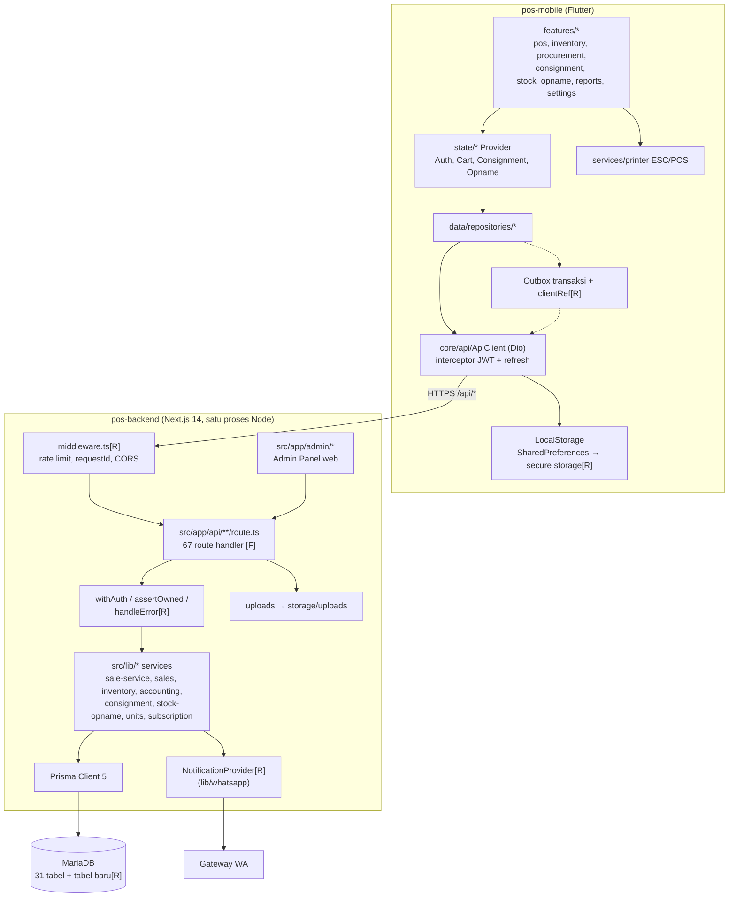
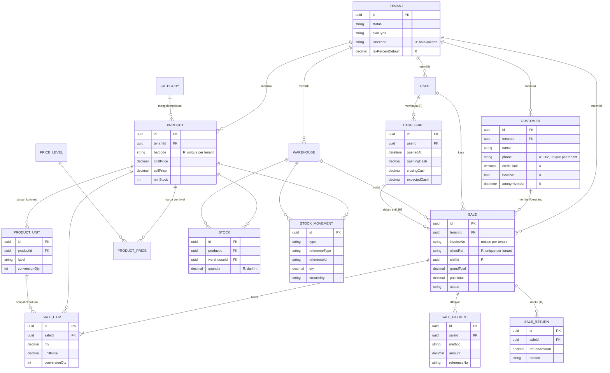
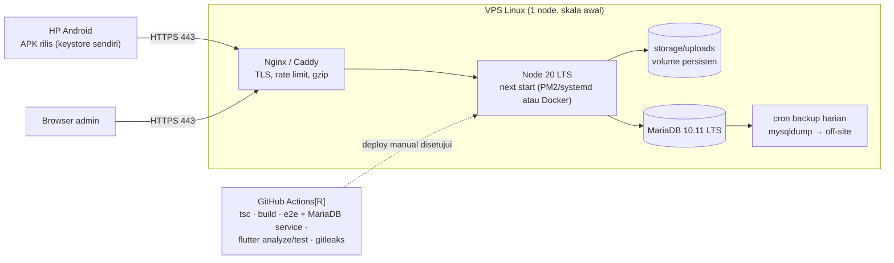

# Arsitektur Teknis — Quantix POS

Tanggal: 22-10-2026 · Analis (T1) · Pasangan: `docs/analysis/requirements.md`
Diagram memakai **Mermaid** (tampil langsung di GitHub/GitLab/VS Code dengan ekstensi Markdown Mermaid).
Label: **[F]** fakta dari kode · **[R]** rekomendasi/target.

## 1. Konteks sistem (C4 level 1)


## 2. Container & komponen backend (C4 level 2–3)


**Aturan lapisan [R]:** route handler hanya parsing (zod) + otorisasi + memanggil service; **semua** logika uang/stok/jurnal
ada di `src/lib/*` dan berjalan dalam `prisma.$transaction`. Route tidak boleh memanggil Prisma untuk menulis data langsung.

## 3. Alur kritis: checkout penjualan (target)
```mermaid
sequenceDiagram
    autonumber
    actor K as Kasir
    participant M as Mobile (Cart/Checkout)
    participant A as API POST /api/sales
    participant S as sale-service
    participant D as MariaDB

    K->>M: Bayar (QRIS 50rb + tunai 50rb)
    M->>M: buat clientRef = UUID v4 (sekali per keranjang)
    M->>A: POST /api/sales {clientRef, items[productId, unitId, qty], payments, customerId?, priceLevelId?}
    A->>A: verifikasi JWT, role, kuota FREE (hari WIB), validasi zod
    A->>S: createSale(tenantId, userId, dto)
    S->>D: BEGIN
    S->>D: SELECT sale WHERE tenant_id, client_ref
    alt clientRef sudah ada
        S-->>A: sale lama (idempoten)
        A-->>M: 200 sale yang sama
    else baru
        S->>D: ambil harga dari Product/ProductPrice, pajak dari Tenant (abaikan harga klien)
        S->>D: cek assertOwned(customerId, warehouseId)
        S->>D: UPDATE stocks SET qty = qty - n WHERE qty >= n (per item)
        S->>D: INSERT stock_movements (SALE)
        S->>D: UPDATE document_counters (INV, yyyyMMdd WIB) → invoiceNo
        S->>D: INSERT sales, sale_items, sale_payments
        S->>D: INSERT journal_entries/lines (kas, piutang, pendapatan, PPN, HPP)
        S->>D: COMMIT
        A-->>M: 201 {sale, invoiceNo, changeAmount}
    end
    Note over S,D: stok kurang → ROLLBACK → 409; unique(tenant_id, client_ref) menangkap race → baca ulang → 200
    M->>M: cetak struk BT, kosongkan keranjang
    Note over M,A: timeout/putus → retry otomatis dengan clientRef yang SAMA (aman)
```

## 4. ERD inti (Transaksi, Stok, Pelanggan)
Entitas bertanda `[R]` adalah usulan baru; tipe `qty` DECIMAL adalah usulan (kini `Int`).

Tabel pendukung lain yang tetap [F]: `Subscription`, `AdminUser`, `RoleMenuPermission`, `Supplier`, `PurchaseOrder*`,
`ChartOfAccount`, `JournalEntry/Line`, `Expense`, `Consignment*`, `StockOpname*`, `PlatformSetting`.
Usulan tambahan non-domain [R]: `DocumentCounter` (penomoran), `AuditLog` (override harga, batal, hapus).

## 5. Integrasi mobile ↔ backend (kontrak)
| Aspek | Saat ini [F] | Target [R] |
|---|---|---|
| Base URL | `--dart-define=API_BASE_URL` (default `http://10.0.2.2:3000`) + `/api`; `update_service.dart` hard-code domain | Semua lewat `AppConfig`; HTTPS wajib di build release |
| Auth | Access JWT 15 m + refresh 30 h, refresh tidak dirotasi; token di SharedPreferences | Refresh dirotasi + `tokenVersion` (revoke saat logout/nonaktif), `flutter_secure_storage`, single-flight refresh |
| Error | Bentuk tidak seragam (`message`, kadang `code`) | `{ message, code, errors?: {field: [pesan]} }`; 401 sesi, 403 izin, 404, 409 konflik (stok/duplikat), 422 validasi, 402/403 kuota FREE |
| Idempotensi | Tidak ada | `clientRef` untuk `POST /sales`, `/sales/{id}/payments`, `/purchase-orders/{id}/receive` |
| Waktu | Zona server, implisit | Server simpan UTC, hitung batas hari dengan `Asia/Jakarta`; respons ISO-8601 dengan offset |
| Paginasi | 6 route | `?page=&limit=` + `meta {page, limit, total}` di semua list |
| Versi app | `/api/version` hard-coded | Versi minimum dari env/DB → app memaksa update bila di bawah minimum |
| Kontrak | `docs/api-contract.md` (sebagian modul) | Lengkapi untuk semua route inti sebelum frontend mulai (sumber tunggal) |

## 6. Deployment (target sederhana)

Catatan: tidak ada Dockerfile/CI saat ini [F]. Skala 1.000 tenant cukup dengan 1 VPS 2–4 vCPU/4–8 GB + MariaDB
di host yang sama; pisahkan DB ke server sendiri saat CPU DB > 60% sustained [R].

## 7. Keputusan arsitektur (ADR ringkas)
| ID | Keputusan | Alasan | Konsekuensi |
|---|---|---|---|
| ADR-01 | Pertahankan monolit modular Next.js + Prisma (bukan rewrite Laravel) | Masalah utama integritas & keamanan, bukan framework; 67 route & e2e sudah ada | Wajib disiplin lapisan route→service; evaluasi ulang bila butuh antrean berat |
| ADR-02 | Multi-tenant satu DB dengan `tenant_id` + `assertOwned` di setiap FK | Biaya ops rendah untuk UMKM | Risiko kebocoran lintas tenant → test otorisasi wajib di CI |
| ADR-03 | Server adalah sumber kebenaran harga, pajak, stok, nomor dokumen | Klien bisa dimodifikasi | Klien hanya kirim id produk/satuan/qty |
| ADR-04 | Idempotensi via `clientRef` sebelum offline-first | Murah (S), langsung menutup risiko transaksi ganda; fondasi untuk outbox offline | Kolom + unique index baru di `sales` |
| ADR-05 | Waktu disimpan UTC, logika hari memakai `Asia/Jakarta` per tenant | Laporan & kuota FREE harus sesuai hari lokal | Util tanggal bersama; uji kasus 23.00–24.00 WIB |
