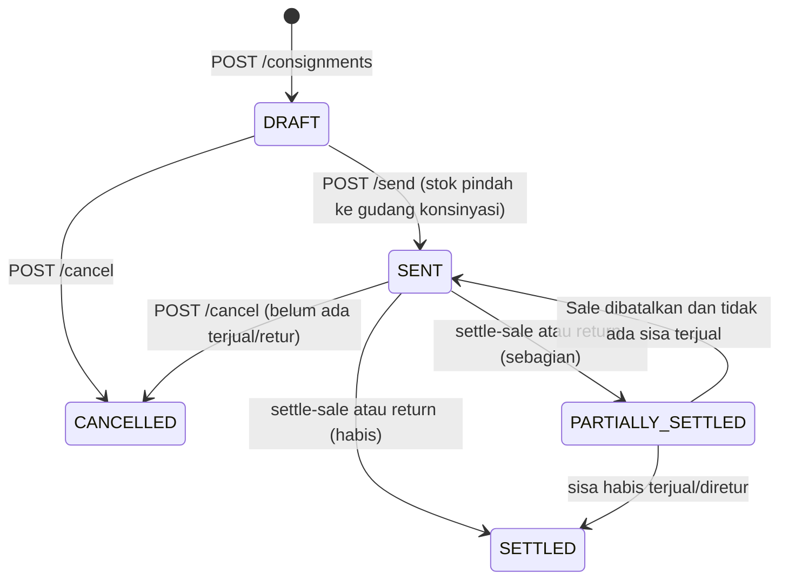

# Modul Konsinyasi (Backend)

Dokumen ini menjelaskan fitur **konsinyasi**: barang milik toko dititipkan ke customer/outlet. Stok tetap milik toko sampai barang terjual. Pendapatan diakui saat outlet melaporkan barang terjual.

Kontrak lengkap (field, validasi, error) ada di [`docs/api-contract.md`](../api-contract.md). Dokumen ini adalah ringkasannya.

> **Status verifikasi:** kode dan kontrak sudah dibaca. `npx prisma validate` berhasil. Skenario end-to-end belum dijalankan terhadap database nyata (lihat bagian "Verifikasi").

---

## 1. Konsep

| Istilah | Arti |
|---|---|
| Gudang asal | Gudang bertipe `STORE` milik toko, tempat barang diambil. |
| Gudang konsinyasi | Gudang bertipe `CONSIGNMENT`, dibuat otomatis satu per customer. Stok di sini = stok fisik di outlet. |
| Dokumen konsinyasi (`ConsignmentOrder`) | Satu surat titip: customer, gudang asal, jatuh tempo, daftar barang. |
| Item | Satu produk + satuan + qty + harga kesepakatan per satuan terpilih. |
| Settlement | Catatan kejadian: `SALE` (barang terjual) atau `RETURN` (barang dikembalikan). |

Aturan utama:
- Semua stok dicatat dalam **satuan dasar** (`baseQty = qty x conversionQty`). `conversionQty` di-snapshot saat dokumen dibuat.
- Kirim dan retur **tidak** membuat jurnal. Jurnal penjualan dibuat saat barang terjual (settle-sale).
- Invarian per item: `baseQtySold + baseQtyReturned <= baseQtySent`. Stok tidak boleh negatif.

## 2. Alur status



Catatan:
- Status dihitung ulang dari item. Semua item `sold + returned == sent` berarti `SETTLED`. Sebagian berarti `PARTIALLY_SETTLED`.
- Membatalkan Sale hasil settle mengurangi `baseQtySold`, lalu status dihitung ulang (bisa kembali ke `SENT`).
- Dokumen `SENT` yang sudah ada barang terjual atau diretur **tidak bisa** dibatalkan langsung. Gunakan retur, atau batalkan Sale terkait dulu.

## 3. Endpoint ringkas

Base URL: `{host}/api`. Semua butuh header `Authorization: Bearer <accessToken>`. `tenantId` diambil dari token.

| Method | Endpoint | Role tulis | Fungsi |
|---|---|---|---|
| GET | `/consignments` | semua | Daftar, filter `status`, `customerId`, `page`, `pageSize` |
| POST | `/consignments` | OWNER, MANAGER | Buat dokumen `DRAFT` (stok belum pindah) |
| GET | `/consignments/{id}` | semua | Detail lengkap (item + settlement) |
| PUT | `/consignments/{id}` | OWNER, MANAGER | Ubah dokumen, hanya `DRAFT` |
| POST | `/consignments/{id}/send` | OWNER, MANAGER | Kirim: stok gudang asal ke gudang konsinyasi |
| POST | `/consignments/{id}/settle-sale` | OWNER, MANAGER | Catat terjual, membuat Sale biasa |
| POST | `/consignments/{id}/return` | OWNER, MANAGER | Retur sisa barang ke gudang asal |
| POST | `/consignments/{id}/cancel` | OWNER, MANAGER | Batalkan (`reason` min. 3 karakter) |
| GET | `/consignments/outlet-stock` | semua | Sisa stok fisik per outlet (`?customerId=` opsional) |

### Contoh (belum diverifikasi terhadap database nyata)

```bash
# Buat dokumen DRAFT: 2 Dus Air Mineral (1 Dus = 24 Botol) untuk satu outlet
curl -X POST "$HOST/api/consignments" \
  -H "Authorization: Bearer $TOKEN" -H "Content-Type: application/json" \
  -d '{
    "customerId": "<customer-uuid>",
    "sourceWarehouseId": "<gudang-toko-uuid>",
    "dueDate": "2026-11-17",
    "items": [ { "productId": "<produk-uuid>", "productUnitId": "<dus-uuid>", "qty": 2, "agreedUnitPrice": 96000 } ]
  }'

# Kirim barang (stok gudang asal -48 Botol, gudang konsinyasi +48)
curl -X POST "$HOST/api/consignments/<id>/send" -H "Authorization: Bearer $TOKEN" -H "Content-Type: application/json" -d '{}'

# Catat 30 Botol terjual (useBaseUnit true = qty dalam satuan dasar)
curl -X POST "$HOST/api/consignments/<id>/settle-sale" \
  -H "Authorization: Bearer $TOKEN" -H "Content-Type: application/json" \
  -d '{ "lines": [ { "consignmentItemId": "<item-uuid>", "qty": 30, "useBaseUnit": true } ], "taxPercent": 11 }'

# Retur 18 Botol sisa ke gudang asal
curl -X POST "$HOST/api/consignments/<id>/return" \
  -H "Authorization: Bearer $TOKEN" -H "Content-Type: application/json" \
  -d '{ "lines": [ { "consignmentItemId": "<item-uuid>", "qty": 18, "useBaseUnit": true } ] }'
```

Penjelasan lengkap body, validasi, dan kode error ada di `docs/api-contract.md` bagian 3.

## 4. Role

- **Baca** (`GET`): semua role tenant, termasuk KASIR.
- **Tulis** (create, update, send, settle-sale, return, cancel): **OWNER dan MANAGER saja**.
- GUDANG tidak boleh menulis. Ini berbeda dari draf analisis awal (`docs/analysis/consignment-fit.md`), dan mengikuti keputusan di kontrak.
- ID dari request (customer, gudang, produk, satuan, item) selalu dicek milik tenant yang sama. Jika tidak, respons 404.

## 5. Perubahan pada endpoint lama

### `GET /api/warehouses` (berubah)
- Query baru `type`: `STORE` (**default bila tidak diisi**), `CONSIGNMENT`, atau `ALL`. Nilai lain menghasilkan 400.
- Setiap gudang kini memuat `type` dan `customerId` (`null` untuk gudang toko).
- Alasan: kasir dan checkout tidak boleh melihat gudang outlet secara tidak sengaja.
- Klien yang butuh semua gudang harus memakai `?type=ALL`.
- `POST /warehouses` selalu membuat gudang `STORE`. `PUT` dan `DELETE` pada gudang `CONSIGNMENT` menghasilkan 409.

### Perbaikan bug (ikut dirilis bersama konsinyasi)

| Endpoint | Bug | Perbaikan |
|---|---|---|
| `POST /sales/{id}/cancel` | Stok dikembalikan `qty`, bukan `qty x conversionQty`. Jual 2 Dus (24 Botol) menambah stok hanya 2. | Stok kembali `qty x conversionQty`. Cancel juga memakai update bersyarat agar tidak bisa dibatalkan dua kali secara paralel. |
| `POST /sales/{id}/payments` | Pelunasan piutang tidak membuat jurnal. Kas/bank dan piutang di buku besar tidak berubah. | Membuat jurnal `SALE_PAYMENT` (Dr Kas atau Bank, Cr Piutang Usaha) sebesar `min(amount, sisa piutang)`. Kelebihan dianggap kembalian dan tidak dijurnal. Cancel Sale ikut membalik jurnal ini. |
| Pembayaran paralel (sales dan purchase-orders) | Konflik transaksi (P2034) tidak ditangani khusus. | Sekarang 409 dengan `code: "CONCURRENT_UPDATE"`. |
| Transaksi konsinyasi | Timeout transaksi default terlalu pendek. | Send, settle-sale, return, dan cancel memakai timeout 20 detik. |
| `adjustStock` | Pengurangan stok paralel bisa membuat stok negatif. | Pengurangan memakai update bersyarat `quantity >= qty`. |

Perbaikan pada Sale dan pembayaran berlaku untuk semua penjualan, tidak hanya konsinyasi.

Catatan data lama: pelunasan piutang yang terjadi **sebelum** perbaikan tidak punya jurnal. Membatalkan Sale lama yang sudah dicicil membalik jurnal penjualan penuh, tetapi jurnal cicilannya tidak ada. Perlu keputusan backfill (belum diputuskan).

## 6. Database dan migrasi

Perubahan skema bersifat **additive** (hanya `CREATE TABLE` dan `ADD COLUMN`, tanpa drop atau rename):

| Tabel | Perubahan |
|---|---|
| `warehouses` | + `type` (`STORE`/`CONSIGNMENT`, default `STORE`), + `customer_id` (nullable) |
| `sales` | + `consignment_order_id` (nullable) |
| `consignment_orders` | Tabel baru: dokumen konsinyasi |
| `consignment_items` | Tabel baru: item dengan snapshot `conversion_qty` |
| `consignment_settlements` | Tabel baru: catatan SALE/RETURN dengan `lines` JSON |

Data gudang lama otomatis bertipe `STORE`.

### Cara menjalankan migrasi `20261017000000_add_consignment`

File: `prisma/migrations/20261017000000_add_consignment/migration.sql`.

Lakukan urutan ini. **Migrasi belum dijalankan** di database mana pun.

```bash
cd C:\laragon\www\pos-backend

# 1. Backup database target dulu (wajib untuk produksi)

# 2. Cek status migrasi terhadap database target (lihat BUG-004 di bawah)
npx prisma migrate status

# 3. Terapkan migrasi
#    Produksi / staging:
npx prisma migrate deploy
#    Pengembangan lokal (dapat membuat migrasi baru bila ada drift):
#    npx prisma migrate dev   (JANGAN memakai skrip "prisma:migrate" di package.json
#                              tanpa memeriksa: skrip itu memakai --name init)

# 4. Generate ulang client Prisma
npx prisma generate
```

Setelah itu, cek build dan tipe:

```bash
npx tsc --noEmit
npm run build
```

Rollback: Prisma tidak membuat skrip rollback otomatis untuk migrasi ini. Jika harus dibatalkan, pulihkan dari backup yang dibuat di langkah 1.

### BUG-004: riwayat migrasi tidak lengkap terhadap skema

- **Gejala:** drift antara riwayat migrasi dan `schema.prisma` yang sudah ada sebelum fitur konsinyasi (pre-existing).
- **Dampak:** `prisma migrate deploy` atau `migrate dev` bisa menghasilkan perubahan yang tidak diharapkan, atau gagal, jika database produksi tidak sama dengan riwayat migrasi.
- **Tindakan wajib:** jalankan `npx prisma migrate status` terhadap database target **sebelum** deploy. Pastikan output tidak menunjukkan drift yang belum dipahami. Jika ada drift, selesaikan dulu (baseline) sebelum menjalankan migrasi konsinyasi.
- **Status:** belum diperbaiki.
- **Sumber:** `docs/handoff/qc.md`. Laporan detail seharusnya di `docs/qc/report.md`, tetapi **folder `docs/qc/` kosong saat dokumen ini ditulis**. Detail BUG-004 belum bisa diverifikasi dari repo.

## 7. Verifikasi

| Pemeriksaan | Status |
|---|---|
| `npx prisma validate` | Berhasil (dijalankan saat penulisan dokumen, `DATABASE_URL` dummy) |
| `npx tsc --noEmit`, `npm run build` | Dilaporkan berhasil di `docs/handoff/backend.md`. Belum dijalankan ulang untuk dokumen ini |
| Test e2e `tests/consignment-e2e.mjs` | Dilaporkan 117 dari 118 pemeriksaan lulus di `docs/handoff/qc.md`. Belum dijalankan ulang. Hanya berjalan terhadap database `qc_consign_test` |
| Migrasi terhadap database | **Belum dijalankan** |

Tidak ada framework test di `package.json`. Skrip test ada di `tests/` (`consignment-e2e.mjs`, `consignment-bulk.mjs`). Cara menjalankannya tercatat di laporan QC, yang belum tersedia di repo (lihat BUG-004).

## 8. Yang belum ada

- Laporan posisi titipan (`GET /reports/consignment`) belum dibuat. Posisi per outlet tersedia di `outlet-stock`.
- Jurnal akun "Persediaan Konsinyasi" belum ada (fase 2). Nilai persediaan total tetap sama.
- Backfill jurnal untuk pelunasan piutang lama belum diputuskan.
- Input metode bayar, diskon, dan pajak di aplikasi mobile saat settle belum ada. Mobile mengirim settle tanpa `payments`.

## Referensi

- Kontrak API: [`docs/api-contract.md`](../api-contract.md)
- Analisis kelayakan: [`docs/analysis/consignment-fit.md`](../analysis/consignment-fit.md)
- Serah terima backend: [`docs/handoff/backend.md`](../handoff/backend.md)
- Serah terima QC: [`docs/handoff/qc.md`](../handoff/qc.md)
- Panduan pengguna mobile: `C:\laragon\www\pos-mobile\docs\manual\konsinyasi-user-guide.md`
